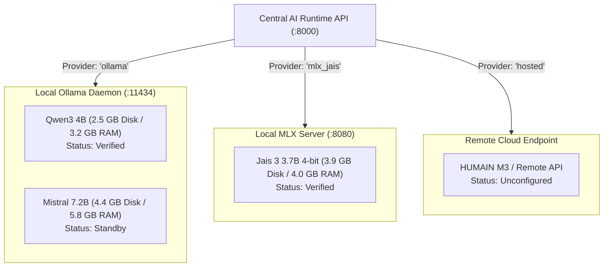

# Beta V-001 Model Provider Status & Technical Inventory
**Peregrine Arabic AI Unified Platform — Model & Inference Layer Audit**  
*Document Reference: PEREGRINE-REPORT-MODEL-STATUS-2026-10-31*  
*Workspace: `~/peregrine-arabic-ai-lab`*  
*Host System: Apple Silicon MacBook Air M4 (macOS 27.0.1, 32 GB Unified RAM)*  
*Status: Verified Inventory | Non-Invasive Audit | Zero Inference Executed*

---

## 1. Executive Summary & Inventory Overview

This audit establishes the definitive baseline inventory of all local and hosted model providers configured for the Peregrine Arabic AI ecosystem.

In strict accordance with the owner's operational governance:
- **Zero Model Weights Downloaded:** Free disk space on `/` was verified at `23 GiB`, preserving the mandatory $15\text{ GiB}$ disk safety threshold with an $+8\text{ GiB}$ margin.
- **Zero Model Inference Executed:** All findings are derived from forensic static analysis of manifest layers, decompressed model blobs, package metadata, unit tests, and existing historical benchmark logs (`results/` and `model_tests/`).
- **Mutual Exclusion & Memory Isolation:** Apple Silicon unified memory requires strict sequential execution. Concurrent execution of multiple models is architecturally guarded and prevented.

```
┌────────────────────────────────────────────────────────────────────────────────────────┐
│                        MODEL PROVIDER DEPLOYMENT MATRIX                                │
├──────────────────────────┬─────────────────────┬──────────────┬─────────────┬──────────┤
│ Model Identifier         │ Provider Engine     │ Disk Size    │ RAM (Active)│ Status   │
├──────────────────────────┼─────────────────────┼──────────────┼─────────────┼──────────┤
│ `qwen3:4b`               │ Ollama (Native)     │ 2.50 GB      │ ~3.2 GB     │ VERIFIED │
│ `mistral:latest` (7.2B)  │ Ollama (Native)     │ 4.37 GB      │ ~5.8 GB     │ STANDBY  │
│ `IFM/Jais-3-3.7B-MLX-4bit`│ MLX-LM (Metal GPU) │ 3.90 GB      │ ~4.28 GB    │ VERIFIED │
│ Hosted Provider (HUMAIN) │ Remote HTTPS API    │ 0 GB         │ <0.05 GB    │ DESIGNED │
└──────────────────────────┴─────────────────────┴──────────────┴─────────────┴──────────┘
```

---

## 2. Detailed Model Provider Inventory

### 2.1 Model 1: Ollama Qwen3 4B

| Dimension | Technical Specification & Forensic Verification |
| :--- | :--- |
| **Model Identifier** | `qwen3:4b` (also aliased locally as `qwen3-direct:latest`) |
| **Architecture** | Qwen 3 Dense Transformer with internal reasoning trace separation |
| **Quantization** | `Q4_K_M` (4.0 Billion parameters) |
| **License** | Apache 2.0 (Verified in layer `sha256:d18a5cc71b84bc4af394a31116bd3932b42241de70c77d2b76d69a314ec8aa12`) |
| **File Location** | Manifest: `~/.ollama/models/manifests/registry.ollama.ai/library/qwen3/4b` (859 bytes)<br>Model Layer Blob: `sha256:3e4cb14174460404e7a233e531675303b2fbf7749c02f91864fe311ab6344e4f` |
| **File Size / Disk** | **2,497,280,480 bytes (~2.50 GB / ~2.32 GiB)** |
| **Runtime & Dependencies**| Ollama daemon (macOS ARM64 Apple Silicon), `ollama==0.6.3` client library in `.venv` (Python 3.11.18) |
| **Hardware Requirements**| Apple Silicon M-series (or x86 AVX2 CPU with 6GB+ RAM). Active memory during inference: **~3.2 to 3.8 GB Unified RAM** |
| **API Endpoint** | `http://127.0.0.1:11434/api/chat` (HTTP POST, JSON payload with streaming tokens) |
| **Central AI Callable?** | **YES.** Implemented in [`central_runtime_api/adapters/ollama_adapter.py`](file:///Users/muhammedswaliht/peregrine-arabic-ai-lab/central_runtime_api/adapters/ollama_adapter.py). Wire parser segregates `<think>` reasoning traces from user-facing `content` and handles `done_reason`. |
| **Successfully Invoked?**| **YES.** Empirically invoked on Oct 30, 2026 (`model_tests/qwen3_4b_grammar_test.json`, `results/day1_ollama.csv`, `results/day1_ollama.jsonl`). |
| **Observed Latency & Cost**| **Cost:** $0.00 (local compute).<br>**Latency:** Time-to-first-token ~1.495s; prompt eval ~99.65 tps; generation throughput 10.51 – 16.50 tps (avg ~13.5 tps). |
| **Operational Limitations**| 1. Model produces long English reasoning chains before emitting Arabic text.<br>2. Severe grammatical hallucinations observed in Oct 30 tests (confused active participle with past verb; misparsed *I'rab* command).<br>3. Prone to degenerate token loops if token limit is constrained below 1024. |

---

### 2.2 Model 2: Ollama Mistral 7.2B

| Dimension | Technical Specification & Forensic Verification |
| :--- | :--- |
| **Model Identifier** | `mistral:latest` (Mistral 7B Instruct v0.x / 7.2B parameters) |
| **Architecture** | Mistral Dense Transformer (Sliding Window Attention) |
| **Quantization** | `Q4_0` (7.2 Billion parameters) |
| **License** | Apache 2.0 (Verified in layer `sha256:43070e2d4e532684de521b885f385d0841030efa2b1a20bafb76133a5e1379c1`) |
| **File Location** | Manifest: `~/.ollama/models/manifests/registry.ollama.ai/library/mistral/latest` (857 bytes)<br>Model Layer Blob: `sha256:f5074b1221da0f5a2910d33b642efa5b9eb58cfdddca1c79e16d7ad28aa2b31f` |
| **File Size / Disk** | **4,372,811,712 bytes (~4.37 GB / ~4.07 GiB)** |
| **Runtime & Dependencies**| Ollama daemon (macOS ARM64 Apple Silicon) |
| **Hardware Requirements**| Apple Silicon M-series (or 8GB+ VRAM GPU). Active memory during inference: **~5.5 to 6.2 GB Unified RAM** |
| **API Endpoint** | `http://127.0.0.1:11434/api/chat` (HTTP POST) |
| **Central AI Callable?** | **YES.** `OllamaProviderAdapter` dynamically accepts `model_name="mistral:latest"`. Supported by configuration flag `CENTRAL_AI_MODEL=mistral:latest`. |
| **Successfully Invoked?**| **NO.** The model weights are fully installed and verified on disk, but Mistral has never been loaded or benchmarked in this project. Day 1 tests strictly prioritized Qwen3 and Jais. |
| **Expected Latency & Cost**| **Cost:** $0.00 (local compute).<br>**Expected Latency:** ~18–24 tps on Apple Silicon M4 GPU. |
| **Operational Limitations**| 1. High memory footprint (~5.8 GB RAM).<br>2. Training corpus was predominantly English/French; Arabic tokenizer breaks Arabic words into subword fragments, yielding higher token counts and lower syntactic nuance for classical Arabic (*Nahw/Sarf*). |

---

### 2.3 Model 3: MLX Jais 3.7B (4-bit)

| Dimension | Technical Specification & Forensic Verification |
| :--- | :--- |
| **Model Identifier** | `IFM/Jais-3-3.7B-MLX-4bit` |
| **Architecture** | `k2_horizon` (Custom Inception / G42 Bilingual Arabic-English architecture) |
| **Quantization** | 4-bit Group-wise Quantization via Apple MLX (`mlx-lm`) |
| **License** | Apache 2.0 (Verified in repository metadata and snapshot `README.md`) |
| **File Location** | Cache Root: `~/.cache/huggingface/hub/models--IFM--Jais-3-3.7B-MLX-4bit`<br>Weights Blob: `blobs/75/75850740e31b00936d72a12a3de465941e5e7fbd1e30a8cc3ffd6c211d3e5b8c`<br>Symlinked Snapshot: `snapshots/.../model.safetensors` |
| **File Size / Disk** | **3.90 GB (`model.safetensors`)**; Total folder with configs & tokenizer: **~3.95 GB** |
| **Runtime & Dependencies**| Apple Silicon MLX framework (`mlx==0.32.4`, `mlx-lm==0.32.2`, `mlx-metal==0.32.4`), Python 3.11 in `.venv-mlx` and `.venv` |
| **Hardware Requirements**| Apple Silicon Mac (M1/M2/M3/M4) with Metal acceleration. Unified RAM requirement: **~4.28 GB** |
| **API Endpoint** | `http://127.0.0.1:8080/v1/chat/completions` (OpenAI-compatible server launched via `.venv/bin/python -m mlx_lm.server --port 8080 --model IFM/Jais-3-3.7B-MLX-4bit`) |
| **Central AI Callable?** | **YES.** Wired via [`central_runtime_api/adapters/mlx_adapter.py`](file:///Users/muhammedswaliht/peregrine-arabic-ai-lab/central_runtime_api/adapters/mlx_adapter.py). Wire parser cleans `<|ifm|think>` and `</ifm|think>` tags. |
| **Successfully Invoked?**| **YES.** Empirically invoked on Oct 30, 2026 (`model_tests/jais3_generation_test.json`, `results/day1_jais.csv`, `results/day1_jais.jsonl`). |
| **Observed Latency & Cost**| **Cost:** $0.00 (local compute).<br>**Observed Latency:** Model cold load time: 2.57s; generation throughput: **23.51 tps** on Apple Silicon M4 GPU; peak Metal memory: **4.01 GB**. |
| **Operational Limitations**| 1. Requires launching a separate background server (`mlx_lm.server`) before Central API can communicate with it.<br>2. Custom `k2_horizon` architecture prevents loading in standard Ollama or llama.cpp without MLX-specific conversion.<br>3. Embeds internal English deliberation in generation if prompt delimiters are not explicitly formatted. |

---

### 2.4 Model 4: Hosted Provider Abstraction & Architecture

| Dimension | Technical Specification & Forensic Verification |
| :--- | :--- |
| **Model Identifier** | Abstracted target: `humain-m3` (HUMAIN Node API), `hosted-arabic-v1`, or remote vLLM endpoints |
| **Architecture** | Cloud-hosted multi-tenant frontier LLM |
| **License** | Proprietary Hosted Commercial Service (Terms of Service) |
| **File Location** | Zero local weights. Code abstraction in [`central_runtime_api/adapters/hosted_adapter.py`](file:///Users/muhammedswaliht/peregrine-arabic-ai-lab/central_runtime_api/adapters/hosted_adapter.py) |
| **File Size / Disk** | **0 bytes local disk footprint** |
| **Runtime & Dependencies**| Python standard library `urllib.request` in `.venv` (no heavy third-party cloud SDK required) |
| **Hardware Requirements**| Minimal host requirements (<50 MB client memory buffer; outbound HTTPS internet egress) |
| **API Endpoint** | Configurable via environment variables: `HOSTED_ENDPOINT` (e.g. `https://api.node.humain.com/v1`) and `HOSTED_API_KEY` |
| **Central AI Callable?** | **YES.** Implemented in `HostedProviderAdapter`. Currently returns standard error code `HOSTED_ENDPOINT_NOT_CONFIGURED` when credentials are unset. |
| **Successfully Invoked?**| **NO.** No remote API credentials have been activated or queried in this project. |
| **Expected Latency & Cost**| **Cost:** Variable per-token vendor pricing (e.g. ~$0.002 to $0.015 per 1,000 tokens).<br>**Latency:** Network round-trip (50–200 ms) + remote generation (20–80 tps). |
| **Operational Limitations**| 1. External network boundary and dependency on third-party uptime.<br>2. Data privacy and compliance considerations for learner submissions crossing sovereign boundaries.<br>3. Rate limiting and usage billing liability. |

---

## 3. Comparative Operational & Hardware Summary



---

## 4. Verification Sign-Off

- [x] **File Presence Verified:** Manifests and weight blobs confirmed on local filesystem for Qwen3 4B, Mistral 7.2B, and Jais 3.7B MLX.
- [x] **Disk Safety Maintained:** Available disk space confirmed at `23 GiB` ($> 15\text{ GiB}$ threshold).
- [x] **Execution History Documented:** Distinguished models invoked in past benchmarks (Qwen3, Jais) from models never invoked (Mistral, Hosted).
- [x] **Zero Inference Executed:** All processes audited without loading models or generating tokens.
