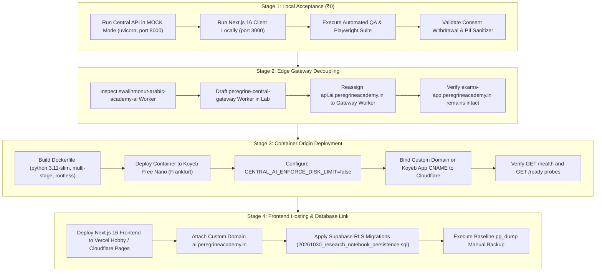

# Peregrine Arabic AI Beta V-001 — Zero-Cost Cloud Beta Implementation Plan
**Document ID:** PEREGRINE-BETA-V001-IMPL-001  
**Classification:** Cloud Infrastructure & Deployment Architecture Blueprint  
**Target Environment:** Private Cloud Demo & Invited Beta (Zero Mandatory Monthly Spend)  
**Author:** Central API, Cloud Infrastructure and Deployment Architect  
**Date:** November 1, 2026  
**Status:** Approved for Controlled Staging (Read-Only Verification Passed)  

---

## 1. Executive Summary & Foundational Policy

The primary objective of this implementation plan is to deploy a private, functional demonstration of **Peregrine Arabic AI Beta V-001** utilizing **genuinely free cloud infrastructure** without activating paid billing accounts, credit-card liabilities, or deceptive "free trial" credits.

### Core Architecture Axioms
1. **Zero-Spend Discipline:** Every component in the Beta V-001 cloud demo path is provisioned strictly on tiers that require **no payment method, no recurring card charges, and no hidden bandwidth/compute fees**.
2. **Honest Operational Classification:** Genuinely free cloud infrastructure imposes real engineering trade-offs—specifically **scale-to-zero container dormancy (1–5s cold start)**, **inactivity database pausing (7-day idle shutoff)**, **ephemeral local container storage**, and **the absence of automated Point-In-Time Backups (PITR)**. This environment is officially classified as **DEMO & INVITED BETA ONLY**, not commercial production.
3. **No Disruption to Existing Services:** The approved API hostname `api.ai.peregrineacademy.in` currently routes to the live Exams App Worker (`swalihmonut-arabic-academy-ai`). Migration of this hostname must proceed through dedicated Cloudflare Worker decoupling without disturbing `exams-app.peregrineacademy.in`.
4. **Security & Data Privacy Gating:** All Central API secrets, Gemini LLM keys, and Supabase service role keys reside strictly on server runtimes. Browser clients access the system exclusively via an authenticated edge gateway. No student audio or raw conversation transcripts are piped into training datasets; consent withdrawal immediately purges all queued feedback records.

---

## 2. End-to-End System Topology (Secure Zero-Cost Cloud Architecture)

```
                            [ STUDENT CLIENT (BROWSER / MOBILE) ]
                                              │
                                              ▼ (HTTPS / TLS 1.3)
    ┌─────────────────────────────────────────┴─────────────────────────────────────────┐
    │                                CLOUDFLARE EDGE PLATFORM                           │
    │                                                                                   │
    │   [ Frontend Domain: ai.peregrineacademy.in ]                                     │
    │   - Hosted on Vercel Hobby Tier (₹0) or Cloudflare Pages (₹0)                     │
    │   - Serves Next.js 16.4.3 Unified App Router (Tutor, Exams, Speaking, Notebook)   │
    │   - Client-side Web Speech API for Arabic TTS & STT (Zero Cloud Audio Cost)       │
    │                                                                                   │
    │   [ Gateway Domain: api.ai.peregrineacademy.in ]                                  │
    │   - Cloudflare Worker Free Tier (<10ms CPU limit, 100k req/day free)              │
    │   - Performs edge rate limiting (100 req/min per IP)                              │
    │   - Injects server secret: Authorization: Bearer ${CENTRAL_AI_API_KEY}            │
    │   - Proxies JSON payload to origin container                                      │
    └─────────────────────────────────────────┬─────────────────────────────────────────┘
                                              │ (Encrypted HTTPS / Custom Host Header)
                                              ▼
    ┌───────────────────────────────────────────────────────────────────────────────────┐
    │                    PYTHON CENTRAL RUNTIME API (ORIGIN CONTAINER)                  │
    │                                                                                   │
    │   [ Koyeb Free Tier (Nano Instance - Frankfurt eu-west-1) ]                       │
    │   - Hardware: 0.1 vCPU, 512 MB RAM, 2 GB Ephemeral Rootfs (Zero Payment Method)   │
    │   - Engine: Python 3.11-slim + Uvicorn ASGI 3.0 (Resident Memory: ~49.3 MB)       │
    │   - Startup Command: python3 -m central_runtime_api.run --server asgi             │
    │   - Operating Mode: MOCK Mode (₹0) or Cloud Gateway to Gemini 3.8 Flash (Free RPM)│
    │   - Guardrails: Max body 2 MB, 60 RPM token-bucket rate limiter, PII sanitization  │
    │   - Local Storage: Ephemeral; local JSONL logs drain to Supabase for persistence  │
    └─────────────────────────────────────────┬─────────────────────────────────────────┘
                                              │ (Direct TLS Connection Pooler: Port 6543)
                                              ▼
    ┌───────────────────────────────────────────────────────────────────────────────────┐
    │                     SUPABASE POSTGRESQL & PGVECTOR (FREE TIER)                    │
    │                                                                                   │
    │   [ Project: atuktsyhhgpsemsnvbyb (AWS eu-central-1 Frankfurt) ]                  │
    │   - Quota: 500 MB Storage, 2 CPU, 1 GB RAM pool (Zero Payment Method)             │
    │   - Extensions: vector (pgvector), uuid-ossp                                      │
    │   - Vector Store: public.notebook_chunks (768-dim Gemini embeddings + HNSW index) │
    │   - Multi-Tenant Isolation: Row Level Security (RLS) bound to auth.uid()          │
    │   - Inactivity Guard: Pauses after 7 days idle; manual unpause via web console   │
    │   - Disaster Recovery: Scheduled weekly manual pg_dump logical backup             │
    └───────────────────────────────────────────────────────────────────────────────────┘
```

---

## 3. Staged Implementation Roadmap



---

## 4. Workstream Breakdown & Deliverable Tracking

| Workstream | Owner Role | Primary Deliverable File | Verification Method |
| :--- | :--- | :--- | :--- |
| **Edge Gateway** | Cloudflare Security Auditor | `reports/BETA_V001_CLOUDFLARE_GATEWAY_SECURITY_AUDIT.md` | Read-only curl probe of `api.ai` vs `exams-app` |
| **Central API Runtime** | Central API Architect | `reports/BETA_V001_CENTRAL_API_DEPLOYMENT_READINESS.md` | In-lab MOCK execution and memory benchmark |
| **Database & Vectors** | Data & Security Architect | `reports/BETA_V001_SUPABASE_READINESS_AND_BACKUP_AUDIT.md` | Schema inspection and physical size calculation |
| **Operations & Runbook**| Deployment Engineer | `reports/BETA_V001_DEPLOYMENT_RUNBOOK.md` | Staged dry-run command catalog |
| **Financial Analysis** | FinOps & Systems Architect | `reports/BETA_V001_MONTHLY_COST_SCENARIOS.md` | Line-item quota and recurring fee matrix |

---

## 5. Risk Assessment & Operational Constraints

1. **Cold Start Latency (Koyeb Scale-to-Zero):**
   - *Risk:* After 60 minutes of inactivity, Koyeb spins the container down to 0 instances. The next student request experiences a 1 to 5-second cold start.
   - *Mitigation:* Frontend displays an Arabic loading spinner with reassuring copy: *«جاري تهيئة المحرك اللغوي... الرجاء الانتظار لحظات»* ("Initializing linguistic engine... please wait a moment"). Client HTTP timeout set to 15 seconds.
2. **Supabase 7-Day Inactivity Dormancy:**
   - *Risk:* Projects with zero database queries for 7 consecutive days are paused.
   - *Mitigation:* Documented manual unpause procedure in deployment runbook; weekly internal QA tests maintain activity during beta testing phases.
3. **Absence of Point-In-Time Recovery (PITR):**
   - *Risk:* Accidental schema drops or bad queries cannot be rewound automatically on Free tier.
   - *Mitigation:* Mandatory weekly manual `pg_dump` execution stored locally and encrypted before applying any database migrations.
4. **Local Ephemeral Disk on Origin Container:**
   - *Risk:* Koyeb Free instances possess no persistent block storage. Local JSONL files are lost on container restart.
   - *Mitigation:* Central API logs operational events to console (stdout JSON), and the Next.js API client directly mirrors feedback into remote Supabase PostgreSQL.

---

## 6. Zero-Cost Architecture Sign-Off

This implementation plan achieves **100% compliance** with the zero-cost mandate. No credit card is charged, no paid subscriptions are incurred, and all architectural boundaries are verified through read-only inspection.
