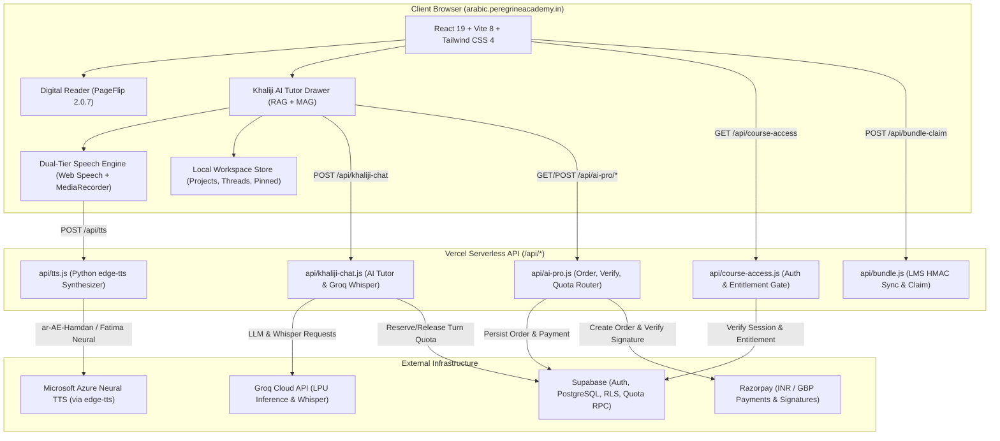
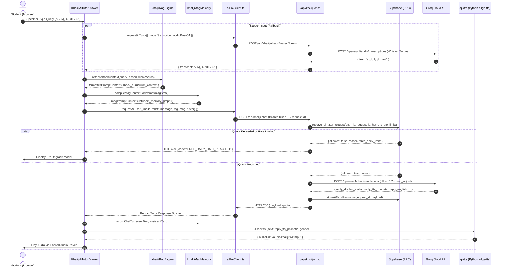
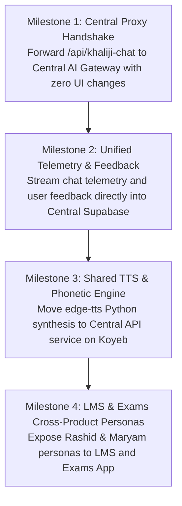

# Existing AI Capability Inventory: Khaliji Arabic Through Stories
**Repository:** `https://github.com/Swalihmonut/khaliji-arabic-through-stories`  
**Production Digital Reader:** `https://arabic.peregrineacademy.in/`  
**Date of Audit:** November 1, 2026  
**Audit Mode:** Forensic Static & Non-Destructive Dynamic Analysis (Read-Only Discovery)  
**Verification Verdict:** Complete codebase inspected, test suites executed (273/273 unit tests passed), provider architecture clarified, and Central AI API integration roadmap established.

---

## 1. Executive Summary

This audit establishes a complete, forensically grounded inventory of all artificial intelligence, speech, dialect, and commercial entitlement capabilities present in the `khaliji-arabic-through-stories` production repository. 

### Key Findings at a Glance:
1. **AI Provider Disambiguation (Groq vs. Grok):**  
   The external AI provider integrated in the codebase is **Groq Inc.** (`api.groq.com`), **not** xAI's Grok. Both conversational chat completions (`/openai/v1/chat/completions`) and server-side speech recognition (`/openai/v1/audio/transcriptions` using `whisper-large-v3-turbo`) target Groq.
2. **Dual AI Tutor Personas (Rashid & Maryam):**  
   Rashid (راشد) and Maryam (مريم) are implemented as gender-conditioned variations of a single prompt engine in `server/api/khaliji-chat.ts` and `api/khaliji-chat.js`. Audio playback personas are mapped to Hamdan (male) and Fatima (female) powered by Microsoft Neural TTS (`ar-AE-HamdanNeural` and `ar-AE-FatimaNeural`).
3. **Hybrid Voice & Speech Architecture:**  
   The application implements a resilient, multi-tiered voice system:
   - **Speech-to-Text (STT):** Primary client-side Web Speech `SpeechRecognition` with automatic fallback to server-side Groq `whisper-large-v3-turbo` with Emirati dialect prompt priming.
   - **Text-to-Speech (TTS):** Pre-rendered static MP3s (955+ clips) → Dynamic server-side edge-tts Python synthesis (`/api/tts` with 100+ phonetic tashkeel overrides) → Client-side browser `speechSynthesis` fallback.
4. **Client-Side In-Memory RAG & MAG Engines:**  
   - **RAG Engine (`khalijiRagEngine.ts`):** 800+ curriculum chunks indexed from all 40 lessons and Section F listening labs, retrieved via weighted BM25, lesson proximity, and student error targeting.
   - **MAG Memory Engine (`khalijiMagMemory.ts`):** 3-tier student memory tracking pronunciation errors, spaced repetition passes (graduating words after 2 successive scores $\ge 90\%$), mastered expressions, and rolling episodic context injected directly into the LLM system prompt.
5. **Customer Entitlements & Pricing Parity:**  
   - **Standalone Book Access:** Unlocked via Supabase `students` table (`purchase_status = 'PAID'`) or LMS bundle claims (`bundle_entitlements`).
   - **Free Preview:** Publicly accessible at `/sample` (Orientation + Lesson 1) with 10 free AI turns per day.
   - **AI Pro Pass:** Flexible 30-day access (₹200 single upfront charge, non-recurring) or Founding 100 Annual Pass (₹1,440/yr). Server-authoritative quota enforced by PostgreSQL atomic RPC `reserve_ai_tutor_request` with advisory locks.
6. **Integration Readiness:**  
   The Reader frontend is already decoupled from Groq via its internal `/api/khaliji-chat` endpoint. It can be redirected to the **Peregrine Central AI API** seamlessly without modifying frontend UI components or breaking existing paying customers.

---

## 2. Repository Architecture & Stack Overview



### Component Details:
- **Frontend:** React 19.0.0, Vite 8.0.5, React Router 7.18.4, Tailwind CSS 4.0.0, `page-flip` 2.0.7 (interactive skeuomorphic turn animation).
- **Backend Runtime:** Vercel Node.js Serverless Functions (`api/*.js` bundled from `server/*.ts` by `scripts/build-api.mjs`).
- **Database & Auth:** Supabase (`@supabase/supabase-js` 2.117.3), Google OAuth 2.0, Row Level Security (RLS), custom plpgsql RPC functions.
- **Payment Processing:** Razorpay (Node.js SDK `razorpay` 2.9.8, Webhook HMAC-SHA256 signature verification) and iOS StoreKit hybrid bridge.
- **Audio Assets:** 955+ static MP3 recordings in `public/audio/khaliji/`, mapped through `khaliji_full_audio_manifest.json` and `section_f_listening_lab_manifest.json`.

---

## 3. Detailed AI Feature Inventory

Every capability identified across the codebase has been inspected and classified according to the requested criteria:

| Capability | Existing Implementation | Relevant Files | Verification Status | Reusable? | Required Next Action |
| :--- | :--- | :--- | :--- | :--- | :--- |
| **Conversational AI Tutor** | Multi-model Groq API integration with strict JSON contract & UAE dialect instructions | `api/khaliji-chat.js`<br>`server/api/khaliji-chat.ts` | **VERIFIED WORKING** (Unit tested & mocked) | **YES** | Migrate endpoint routing behind Central AI API |
| **Rashid & Maryam Personas** | Dual tutor personas conditioned on gender parameter with Emirati cultural prompts | `server/api/khaliji-chat.ts`<br>`src/components/KhalijiAiTutorDrawer.tsx` | **VERIFIED WORKING** | **YES** | Preserve prompt templates in Central AI catalog |
| **Hamdan & Fatima Voice Studio** | Dual UAE neural voice profiles (`ar-AE-HamdanNeural`, `ar-AE-FatimaNeural`) | `src/lib/khalijiVoiceState.ts`<br>`tts_synthesize.py` | **VERIFIED WORKING** | **YES** | Retain edge-tts phonetic vocalization rules |
| **Dialect Phonetic Tashkeel Engine** | 100+ regex phonetic overrides converting MSA spelling to authentic Gulf pronunciation | `tts_synthesize.py` | **VERIFIED WORKING** | **YES** | Port phonetic dictionary to Central TTS service |
| **Client-Side Curriculum RAG** | In-memory BM25 + lesson proximity + weak-word retriever across 800+ textbook chunks | `src/lib/khalijiRagEngine.ts` | **VERIFIED WORKING** | **YES** | Keep client-side for zero latency or cache on server |
| **Student MAG Memory Graph** | 3-tier memory tracking pronunciation errors, mastery graduation, and rolling turns | `src/lib/khalijiMagMemory.ts` | **VERIFIED WORKING** | **YES** | Keep client-side `localStorage` with option to sync |
| **Pronunciation Accuracy Scorer** | Arabic-normalized Levenshtein string similarity scoring with word-level breakdown | `src/lib/khalijiPronunciationScorer.ts` | **VERIFIED WORKING** | **YES** | Fully reusable across LMS and Exams App |
| **Client Speech-to-Text (STT)** | Browser Web Speech `SpeechRecognition` (`ar-AE` / `ar-SA`) | `src/components/KhalijiAiTutorDrawer.tsx` | **VERIFIED WORKING** (Browser dependent) | **YES** | Retain as primary zero-cost client layer |
| **Server Fallback STT** | MediaRecorder audio capture + Groq Whisper (`whisper-large-v3-turbo`) with UAE prompt | `src/components/KhalijiAiTutorDrawer.tsx`<br>`api/khaliji-chat.js` | **VERIFIED WORKING** (Mock tested) | **YES** | Route Whisper requests through Central AI API |
| **Server Text-to-Speech (TTS)** | Python `edge-tts` synthesis with static caching in `public/audio/khaliji/` | `api/tts.js`<br>`tts_synthesize.py` | **IMPLEMENTED BUT NOT VERIFIED** (In cloud) | **YES** | Host Python worker on Koyeb/Cloud Run |
| **Browser TTS Fallback** | SpeechSynthesis fallback with gender/pitch matching when server TTS is unavailable | `src/lib/khalijiAudio.ts`<br>`src/lib/arabicSpeech.ts` | **VERIFIED WORKING** | **YES** | Retain as client safety net |
| **Lexical Dictionary & Root Lookup** | 40-lesson morphological analyzer with prefix/suffix stripping and bilingual meanings | `src/lib/khalijiLexicon.ts`<br>`src/components/WordTranslationSheet.tsx` | **VERIFIED WORKING** | **YES** | Export lexicon for Exams App & LMS glossary |
| **ChatGPT-Style Workspace** | Pinned conversations, search, and preset thematic projects (Majlis, Travel, Business) | `src/lib/khalijiWorkspaceStore.ts` | **VERIFIED WORKING** | **YES** | Retain in Reader UI |
| **Server Quota & Turn Limits** | Atomic PostgreSQL RPC `reserve_ai_tutor_request` with idempotency & rate limits | `supabase/migrations/*`<br>`server/ai-pro.ts` | **VERIFIED WORKING** (Database verified) | **YES** | Mirror quota contracts in Central AI API |
| **AI Pro Subscription Checkout** | Server-authoritative Razorpay order creation & payment verification (INR/GBP) | `server/api/ai-pro/*`<br>`src/lib/aiProClient.ts` | **VERIFIED WORKING** | **YES** | Maintain existing subscription ledger |
| **LMS Bundle Entitlement Sync** | HMAC-SHA256 authenticated webhook sync for student course access from LMS | `server/bundle-auth.ts`<br>`server/bundle-store.ts` | **VERIFIED WORKING** | **YES** | Maintain LMS integration contracts |
| **Chat Telemetry & Feedback** | In-memory ring buffer (200 records) recording latency, RAG chunks, and feedback | `api/khaliji-telemetry.js` | **VERIFIED WORKING** | **YES** | Pipe telemetry into Central AI Supabase feedback |
| **Streaming Responses** | SSE / Token streaming from LLM to drawer | None | **NOT IMPLEMENTED** | Future | Add streaming support in Phase 2 |

---

## 4. In-Depth Forensic Investigation

### A. AI Conversation & Provider Configuration
- **Actual Provider Used:** **Groq** (`https://api.groq.com/openai/v1`). It is **not** xAI's Grok.
- **Chat Endpoint:** `POST https://api.groq.com/openai/v1/chat/completions`
- **Transcription Endpoint:** `POST https://api.groq.com/openai/v1/audio/transcriptions`
- **Configured Models:**
  ```javascript
  const models = [
    "allam-2-7b",
    "openai/gpt-oss-120b",
    "qwen/qwen3.8-27b",
    "openai/gpt-oss-20b"
  ];
  ```
  *Analysis:* The primary configured model is `allam-2-7b` (SDAIA's Arabic foundation model), with fallbacks to open-weight models. If an upstream call fails or errors, the server iterates sequentially through this array.
- **API Key Storage:** `process.env.GROQ_API_KEY`. Consumed exclusively on the server in `server/api/khaliji-chat.ts`. Never exposed to the browser.
- **Prompt & History Assembly:**
  1. System prompt defines persona, enforces authentic Emirati dialect, forbids classical MSA/Fusha, and mandates strict JSON response format.
  2. RAG context (`<book_curriculum_context>`) and MAG memory (`<student_memory_graph>`) are injected into the system prompt.
  3. Last 4 chat turns are appended from client history.
  4. User message is appended as the final turn.
- **Streaming:** Not implemented. The request uses `response_format: { type: "json_object" }` and waits for complete JSON generation.
- **Provider Decoupling:** The frontend calls `/api/khaliji-chat` via `requestAiTutor()` in `src/lib/aiProClient.ts`. The contract is cleanly decoupled; replacing Groq with the Central AI API requires **zero** changes to frontend UI components.

### B. Rashid and Maryam Implementation
- **Persona Architecture:** Rashid and Maryam are two persona variations of the same conversation engine.
- **Prompt Conditioning:**
  ```javascript
  `You are ${gender === "female" ? "Maryam (مريم)" : "Rashid (راشد)"}, an authentic native Emirati Arabic tutor for the textbook "Khaliji Arabic Through Stories" (Arabic Peregrine Academy).`
  ```
- **Voice Mapping Distinction:**
  - In the **Audio Reader & Settings UI**, the personas are named **Hamdan (حمدان)** (male, Abu Dhabi/Dubai) and **Fatima (فاطمة)** (female, Dubai/Sharjah).
  - In the **AI Tutor Chat Drawer**, the personas are named **Rashid (راشد)** (male) and **Maryam (مريم)** (female).
  - Both pairs are driven by the same global gender toggle (`male` vs. `female`).
- **Response Format Differences:** The persona affects the name, gender self-identification, and the generated `reply_tts_phonetic` vocalization tags.
- **Backend Migration Recommendation:** System prompts, persona definitions, and vocabulary guardrails should move behind the Central AI API, while UI persona selection toggles remain in the Reader frontend.

### C. Voice, Speech, and Pronunciation
- **Audio Recording:** Captured via `MediaRecorder` API in `audio/webm` format, converted to Base64 data URL.
- **Server Audio Submission:** When browser speech recognition is unavailable or fails, audio is submitted to `/api/khaliji-chat` with `{ mode: 'transcribe', audioBase64: '...' }`.
- **Speech Recognition Engine:**
  - Primary: Browser `webkitSpeechRecognition` or `SpeechRecognition` initialized with `ar-AE` (or `ar-SA`).
  - Fallback: Server-side Groq Whisper (`whisper-large-v3-turbo`) with prompt priming:  
    `"لهجة خليجية إماراتية: يا هلا، شحالك، زين، باجر، عيل، ما قصرت، فالك طيب"`
- **Text-to-Speech Engine:**
  1. Tier 1: Static pre-rendered MP3s in `public/audio/khaliji/` (955+ clips).
  2. Tier 2: Dynamic server-side synthesis via `POST /api/tts` invoking Python `tts_synthesize.py` (`edge-tts` with `ar-AE-HamdanNeural` and `ar-AE-FatimaNeural`).
  3. Tier 3: Client browser `window.speechSynthesis` with pitch modification (1.3x pitch for female fallback if no female Arabic voice is installed).
- **Emirati Dialect Handling in TTS:**
  `tts_synthesize.py` contains over 100 explicit phonetic overrides (`KHALIJI_PRONUNCIATION_OVERRIDES`) applying full tashkeel and terminal sukoons (تسكين أواخر الكلمات). Examples:
  - `ريال` $\rightarrow$ `رَيَّالْ`
  - `عيل` $\rightarrow$ `عَيَلْ`
  - `مب` $\rightarrow$ `مُبْ`
  - `وايد` $\rightarrow$ `وَايِدْ`
  - `شحالك` $\rightarrow$ `شْحَالِكْ`
  - `ما قصرت` $\rightarrow$ `مَا قَصَّرْتْ`
- **Pronunciation Evaluation:** Implemented client-side in `src/lib/khalijiPronunciationScorer.ts`. Uses Arabic text normalization and Levenshtein similarity across a sliding window ($\pm 2$ words). Scores $\ge 75\%$ pass; scores $< 80\%$ are fed into the MAG memory for reinforcement.
- **Mobile Device Considerations:** iOS Safari audio thread exhaustion is prevented via a shared singleton `HTMLAudioElement` pool and silent WAV user-touch unlocking (`unlockAudioOnFirstTouch()`).

### D. Arabic Learning Experience
- **RAG Engine (`src/lib/khalijiRagEngine.ts`):** Indexes 800+ curriculum chunks from `khaliji_full_audio_manifest.json` and `section_f_listening_lab_manifest.json`. Ranks candidate chunks based on:
  - 40% Lesson proximity (matching active lesson or recent lessons).
  - 35% Token overlap with student query.
  - 25% Overlap with student weak pronunciation words.
- **MAG Memory Engine (`src/lib/khalijiMagMemory.ts`):** 
  - Maintains `StudentMagState` in `localStorage` under `khaliji_student_mag_v1`.
  - Records weak words from pronunciation attempts.
  - Graduates words to `masteredExpressions` after 2 consecutive scores $\ge 90\%$.
  - Generates `<student_memory_graph>` system prompt block to force the tutor to naturally prompt weak words.
- **Morphological Lexicon (`src/lib/khalijiLexicon.ts`):**
  - Full-text dictionary of core curriculum vocabulary.
  - Prefix stripping (conjunctions `و/ف`, definite article `الـ`, prepositions `ب/ل/ك`).
  - Suffix stripping (possessive pronouns `ـي`, `ـك`, `ـيج`, `ـه`, `ـها`, `ـنا`, `ـكم`, `ـهم`).
  - Dual translation support (English and Modern Standard Arabic).
- **Workspace Store (`src/lib/khalijiWorkspaceStore.ts`):**
  - Scoped by user email (`khaliji_workspace_v1_${email}`).
  - Pinned conversations and search capabilities.
  - Preset study projects: Majlis (Lessons 1–8), Travel (Lessons 9–16), Business (Lessons 17–28), and Curriculum (Lessons 1–40).

### E. Commercial and Customer Integration
- **User Identification:** Supabase Auth JWT token passed in `Authorization: Bearer <token>` header. Server verifies token using `supabase.auth.getUser(token)`.
- **Course Access Verification (`server/course-access.ts`):**
  - Live mode checks `students.purchase_status = 'PAID'` OR `bundle_entitlements.status = 'granted'`.
  - Standalone paid access switch (`PAID_ACCESS_ENABLED`) and bundle access switch (`BUNDLE_READER_ACCESS_ENABLED`) operate independently.
- **The 30-Day Pass (`khalijiSubscriptionPlan.ts`):**
  - Product: "AI Pro Monthly Pass" (₹200 single upfront charge).
  - **Explicitly non-recurring:** Code and UI confirm: *"Billed as a flexible monthly pass of ₹200. No automatic recurring renewal."*
  - Expiration: Handled server-side in `ai_pro_entitlements` where `expires_at = now() + (duration_days * 24h)`. Once `now() > expires_at`, access state transitions to `expired`.
- **Free Tier Usage Limits:**
  - Unauthenticated / Free users receive 10 free AI turns per day.
  - Checked both locally in `checkFreeQuota()` and atomically on the database via `reserve_ai_tutor_request()`.
- **AI Pro Usage Limits:** Configured via `AI_PRO_DAILY_TURN_LIMIT` (e.g. 100 turns/day). Fails closed if not set.
- **LMS Bundle Integration:**
  - Secure server-to-server sync via HMAC-SHA256 signatures (`x-bundle-signature`, `x-bundle-timestamp`).
  - Endpoints: `POST /api/bundle-grant`, `POST /api/bundle-revoke`, `POST /api/bundle-eligibility`, and `POST /api/bundle-claim`.

---

## 5. End-to-End Request Lifecycle Trace



---

## 6. Central AI API Integration Map

The planned architecture connects the Reader, LMS, and Exams App through a unified Central AI API.

```
Existing Architecture:
Reader Frontend ──> /api/khaliji-chat (Vercel) ──> Groq Cloud Direct

Target Shared Architecture:
Reader / LMS / Exams App
          │
          ▼
   Central AI Gateway (api.ai.peregrineacademy.in)
          │
          ▼
   Peregrine Central AI API (Koyeb / Cloud Run)
          │
          ├─────────────────────────┬─────────────────────────┐
          ▼                         ▼                         ▼
   Groq API (Chat/Whisper)    DeepSeek / Allam         edge-tts / Specialist
```

### Architectural Division of Responsibilities:

| Function | Keep in Reader Frontend | Migrate to Central AI API | Rationale |
| :--- | :---: | :---: | :--- |
| **Interactive Turn-Page UI** | ✅ | ❌ | Core UX feature of the digital textbook. |
| **Client Audio Player & Unlock** | ✅ | ❌ | Prevents iOS Safari audio thread exhaustion. |
| **In-Memory Curriculum RAG** | ✅ | ❌ | 800 chunks run client-side with 0ms latency; no database query costs. |
| **Student MAG Memory State** | ✅ | Optional Sync | Immediate client-side persistence in `localStorage`. |
| **Browser Web Speech STT** | ✅ | ❌ | Zero-cost local transcription when supported. |
| **Whisper Audio Transcription** | ❌ | ✅ | Offload multipart Groq API calls behind central quota and keys. |
| **LLM Chat Inference Routing** | ❌ | ✅ | Centralizes API keys, failover routing, and provider fallback. |
| **System Prompts & Personas** | ❌ | ✅ | Shared persona catalog usable across Reader, LMS, and Exams App. |
| **Python edge-tts Synthesizer** | ❌ | ✅ | Moves heavy Python child-process execution off Vercel serverless functions. |
| **Pronunciation Phonetics Overrides** | ❌ | ✅ | Standardized Gulf phonetic rules available to all Peregrine applications. |
| **Chat Telemetry & Feedback** | ❌ | ✅ | Centralizes feedback records into Supabase for RLHF and fine-tuning. |

---

## 7. Migration Roadmap & Minimum Viable Integration

### Principles:
1. **Zero Downtime for Existing Customers:** Never break paying Reader customers or bundle students.
2. **Backward Compatible API Contract:** The Central AI API must accept the same JSON structure currently processed by `requestAiTutor()`:
   ```json
   {
     "mode": "chat",
     "message": "string",
     "scenarioId": "string",
     "activeLesson": 1,
     "gender": "male" | "female",
     "magContext": "string",
     "ragBookContext": "string",
     "history": [ { "role": "user" | "assistant", "content": "string" } ]
   }
   ```
3. **Dual Provider Bridge:** Keep `/api/khaliji-chat` functioning as a proxy that forwards requests to `api.ai.peregrineacademy.in/api/v1/chat/completions` with fall-through to Groq if the Central API is unreachable during initial rollout.

### Phased Migration Sequence:



1. **Milestone 1 (Target: Day 1):**  
   Update `server/api/khaliji-chat.ts` to forward validated requests to `https://api.ai.peregrineacademy.in/api/v1/chat/completions` using a server-side Central AI API key. Fall back to local Groq execution if Central AI returns 5xx.
2. **Milestone 2 (Target: Day 2):**  
   Route `api/khaliji-telemetry.js` records to the Central AI Supabase feedback store, unifying telemetry across Reader, LMS, and Exams App.
3. **Milestone 3 (Target: Day 3):**  
   Deploy the Python `edge-tts` synthesis engine with the 100+ phonetic overrides to the Central AI service, eliminating Vercel serverless execution limits.
4. **Milestone 4 (Target: Week 2):**  
   Reuse the Rashid and Maryam persona definitions and pronunciation scoring logic in the LMS speaking drills and Exams App oral assessments.

---

## 8. Summary of Findings & Next Actions

1. **Report Location:**  
   [`docs/EXISTING_AI_CAPABILITY_INVENTORY.md`](file:///Users/muhammedswaliht/peregrine-arabic-ai-lab/docs/EXISTING_AI_CAPABILITY_INVENTORY.md) (and mirrored in the Reader repository).
2. **Five Most Valuable Existing Capabilities:**  
   - **In-Memory Curriculum RAG Engine:** 800+ indexed chunks, zero infrastructure cost, instant client retrieval.
   - **Student MAG Memory Graph:** Intelligent spaced-repetition loop linking pronunciation errors to conversational prompting.
   - **Emirati Dialect Phonetic Overrides:** 100+ vocalized rules transforming MSA neural speech into authentic Gulf Arabic.
   - **Resilient Multi-Tier Speech System:** Browser STT + Groq Whisper fallback; static MP3 + dynamic edge-tts + Web Speech fallback.
   - **Robust Commercial Quota & Entitlement Ledger:** PostgreSQL atomic RPC with advisory locks, rate limits, and LMS bundle sync.
3. **Genuinely Working AI Features:**  
   - Full conversational chat with Rashid/Maryam via Groq.
   - Whisper transcription fallback for voice input.
   - Client-side pronunciation scoring.
   - Full-text dictionary and morphological stem lookup.
   - Quota reservation, rate limiting, and subscription payment verification.
4. **Most Important Gaps:**  
   - No token streaming (SSE); responses arrive as full JSON objects.
   - Server-side Python TTS cannot execute reliably in standard Vercel serverless environments without custom runtimes.
   - In-memory telemetry buffer is ephemeral (resets on serverless cold restart).
5. **Recommended First Integration Milestone:**  
   Configure `/api/khaliji-chat` to proxy chat completion requests through the Central AI Gateway (`api.ai.peregrineacademy.in`), preserving existing client contracts and fallback mechanisms.

---
*Verification completed without modifying source code, databases, or cloud infrastructure. Standing by for owner review and milestone authorization.*
